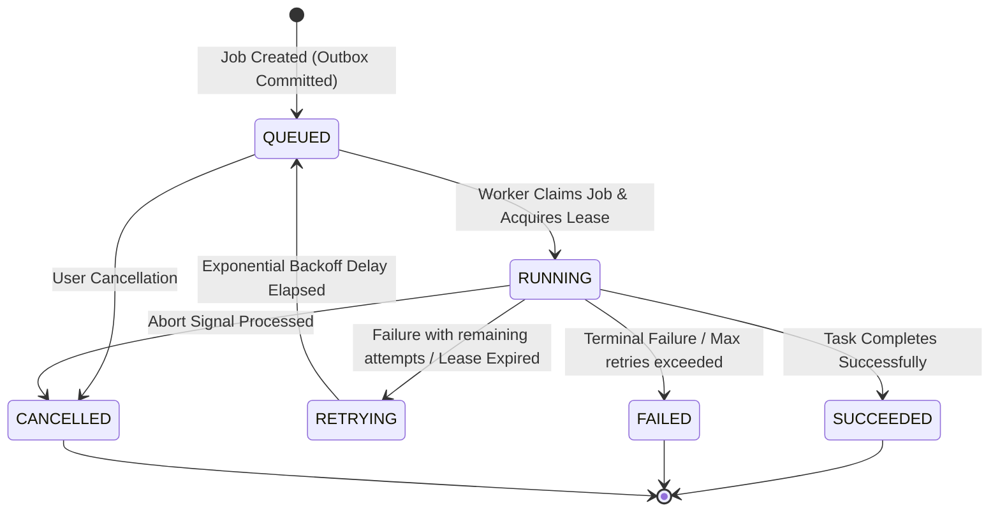

# TaskMesh System Architecture & Lifecycle Specification

## 1. Overview
TaskMesh is a distributed, resilient task execution platform. The core tenet of TaskMesh is that **PostgreSQL is the source of truth**, while **Redis provides ephemeral coordination, prioritization, and queue dispatching**.

---

## 2. Job States & State Machine

Every task tracked within TaskMesh transitions through an explicit state machine:



### State Definitions
- **QUEUED**: The job has been durably stored in PostgreSQL and pushed (or ready to be pushed) into the active Redis scheduling structure.
- **RUNNING**: A worker process has claimed the job, acquired an active distributed lease in Redis, and is currently executing the task payload.
- **RETRYING**: The execution failed (or the worker heartbeat timed out), but remaining retries exist. The job is delayed according to the backoff schedule before transitioning back to `QUEUED`.
- **SUCCEEDED**: The worker execution completed successfully; return value or execution artifacts are persisted in PostgreSQL.
- **FAILED**: Execution encountered an unrecoverable error or exhausted all retry attempts.
- **CANCELLED**: The job was explicitly stopped by a user or upstream trigger before or during execution.

---

## 3. Storage & Coordination Strategy

### PostgreSQL as the Authoritative Store
PostgreSQL holds all permanent records with ACID guarantees:
- **`jobs` table**: Defines job configuration, metadata, idempotency key, current state, priority, retry budget, execution timestamps, and final result/error payload.
- **`outbox_events` table**: Transient events written in the same transaction as job state updates.
- **`job_runs` table**: Audit trail recording each distinct attempt, worker node ID, duration, and output/stack traces.

### Redis as the Coordination & Fast Queue Layer
Redis provides high-throughput, low-latency primitives:
- **Priority Queuing**: Implemented using Redis Sorted Sets (`ZSET`) where the score represents the calculated priority and earliest dispatch timestamp ($T_{\text{sched}}$).
- **Worker Leases & Heartbeats**: When a worker claims a job, it sets a lease key in Redis (`job:lease:<job_id>`) with an expiration TTL (e.g., 60 seconds). As long as the task runs, the worker pings Redis to refresh the TTL. If the worker crashes, the lease expires.
- **Real-Time Pub/Sub**: Used to notify the API server for Server-Sent Events (SSE) streaming updates to connected frontend clients.

---

## 4. Transactional Outbox Pattern

To prevent the classic dual-write distributed failure (e.g., database transaction commits, but network fails before publishing to Redis):

1. **Step 1 (Atomic Commit)**: The API receives a job submission. Within a single PostgreSQL transaction:
   ```sql
   INSERT INTO jobs (id, status, priority, payload, ...) VALUES (...);
   INSERT INTO outbox_events (id, event_type, payload, status) VALUES (...);
   ```
2. **Step 2 (Dispatcher Sweep)**: An independent **Queue Dispatcher** daemon queries unprocessed events with row locks:
   ```sql
   SELECT * FROM outbox_events WHERE status = 'PENDING' ORDER BY created_at ASC LIMIT 100 FOR UPDATE SKIP LOCKED;
   ```
3. **Step 3 (Publish & Confirm)**: The Dispatcher pushes the job into Redis and marks the outbox event as `PROCESSED` in PostgreSQL.

If the API or Dispatcher crashes at any point, uncommitted jobs never reach the queue, and unprocessed outbox events are safely re-read by the next Dispatcher cycle without message loss.

---

## 5. Resilience, Fault Tolerance & Scheduling

### Idempotency Keys
- Every job submission can accept a client-provided `idempotency_key` (e.g., UUID or unique business token).
- PostgreSQL enforces a unique constraint: `UNIQUE(tenant_id, idempotency_key)`.
- Re-submitting an identical idempotency key returns the existing job status without scheduling duplicate executions.

### Priority Scheduling & Ordering Policy
- Jobs support configurable numeric priorities:
  - `1 = LOW`
  - `5 = NORMAL`
  - `8 = HIGH`
  - `10 = CRITICAL`
- The Redis Sorted Set uses a composite score combining priority and scheduled timestamp:
  $$\text{Score} = \text{TargetTimestamp} - (\text{Priority} \times 100000)$$
  This guarantees that critical and high-priority jobs pop ahead of normal and low-priority jobs, while older low-priority jobs are protected from starvation over time.
- **Non-Preemption Guarantee**: In TaskMesh, priority strictly determines the dispatch ordering from the pending queue. **Priority does NOT preempt, interrupt, or evict a task that is already running or claimed by a worker with an active lease.** Once a worker claims a job, it executes to completion, failure, or cancellation checkpoint.


### Bounded Retries & Exponential Backoff
- Each job defines `max_retries` (default: 3).
- On retryable failure, backoff delay is computed:
  $$\text{Delay} = \min(\text{max\_backoff}, \text{initial\_backoff} \times 2^{\text{retry\_count}} + \text{jitter})$$
- The job is re-added to Redis with a schedule score set to $\text{now} + \text{Delay}$.

### Worker Leases and Crash Recovery
- Workers run an asynchronous heartbeat loop every $\frac{\text{TTL}}{3}$ seconds.
- A supervisory loop or Dispatcher reaps jobs that are marked `RUNNING` in PostgreSQL whose Redis lease has expired without completion.
- Reaped jobs are automatically transitioned to `RETRYING` or `FAILED`.

### Concurrency Limits
- Per-queue or per-worker concurrency limits are enforced via Redis token buckets or semaphore counters (`INCRBY` / `DECRBY`).

---

## 6. Service Boundaries

| Service | Responsibility | Runtime Process |
| :--- | :--- | :--- |
| **API Server** | HTTP REST & SSE endpoints, client validation, outbox insertion | `uvicorn app.main:app` |
| **Queue Dispatcher** | Polling PostgreSQL outbox and populating Redis queues | `python -m app.workers.dispatcher` |
| **Task Worker** | Polling Redis, acquiring leases, executing tasks, updating DB | `python -m app.workers.runner` |
| **PostgreSQL** | Authoritative relational storage and transactional outbox | Containerized PostgreSQL 16+ |
| **Redis** | In-memory sorted sets, leasing locks, pub/sub for SSE | Containerized Redis 7+ |
| **Frontend UI** | Real-time monitoring dashboard, task submission, visualizer | React + Vite + Tailwind/TS |

---

## 7. Health Checks & Observability

- **API Server**:
  - `/healthz`: Liveness check (process responds).
  - `/ready` / `/health/ready`: Readiness check (validates live connectivity to both PostgreSQL and Redis).
  - `/health/metrics`: System metrics exposing Redis queue depths (pending, processing, DLQ) and PostgreSQL status counts.
- **Structured Logging**:
  - JSON-formatted structured logging standard across all backend processes with `job_id`, `worker_id`, `attempt`, `event`, and `level`.

---

## 8. Reliability, Crash Safety & Execution Guarantees

### Duplicate Submission vs. Duplicate Execution
- **Duplicate Job Submission (Idempotent API)**:
  - If a client resubmits a job with the same `idempotency_key` and matching payload/type, the API returns the original job record without duplicating work or queue entries.
  - If a client attempts to reuse the same `idempotency_key` with a materially different payload or task type, the request is rejected with `409 Conflict`.
- **At-Least-Once Execution Guarantee (No Arbitrary Exactly-Once)**:
  - TaskMesh provides **at-least-once execution**.
  - We do **not** claim arbitrary "exactly-once" execution for external side-effects (e.g. sending emails, debiting credit cards). If a worker process crashes after performing an external side effect but before committing the `SUCCEEDED` transaction to PostgreSQL, the supervisory lease recovery will re-queue the task for retry.
  - **Requirement for Side Effects**: External task operations must be designed to be idempotent (e.g. using unique charge tokens, upstream idempotency keys, or two-phase commit).

### Worker Fencing Tokens & Stale Zombie Rejection
- When a worker claims a job, an exclusive lease TTL is registered in Redis alongside an attempt-specific fencing token.
- Before committing final execution results to PostgreSQL, the worker verifies that it still holds the active lease in Redis.
- If a slow or paused worker experiences an extended network partition or GC pause causing its lease to expire and be claimed by another worker, the stale worker's commit is safely aborted.

### Permanent vs. Retryable Error Distinction
- **Permanent Errors** (`PermanentTaskError` or schema input validation failures): Terminal from attempt 1. No retries or backoff delays are scheduled.
- **Retryable Errors** (e.g. network drops, temporary external outages): Rescheduled using exponential backoff with full jitter up to `max_attempts`.
- **Cancelled Tasks**: Cooperative checkpoints inside task execution immediately cease work, transition to `CANCELLED`, and prevent any scheduled retries.

---

## 9. Execution Cycles & Failure Telemetry

### Retry Semantics & Execution Cycles
- **Definition of `max_attempts`**: `max_attempts` represents the maximum number of attempts allowed **within a single execution cycle**.
- **Automatic Retries**: Within an active cycle, automatic retries increment `attempt_count` and `total_attempt_count`. If `attempt_count >= max_attempts`, the cycle terminates in `FAILED` with classification `RETRY_BUDGET_EXHAUSTED`.
- **Manual Retries**: A permitted manual retry of a terminal job (`FAILED` or `CANCELLED`) initiates a **new execution cycle** (`execution_cycle += 1`).
  - Current-cycle `attempt_count` is reset to 0 to grant a fresh retry budget of `max_attempts`.
  - `total_attempt_count` retains lifetime execution history and is never reset.
  - Previous failure events, diagnostics, and timestamps remain preserved in PostgreSQL audit events (`JobEvent`).
- **Cycle Fencing**: Queue payloads and worker fencing tokens carry the originating `execution_cycle`. If a stale worker completes work on an earlier cycle after a manual retry has advanced the job, the worker's commit is safely aborted (`CYCLE FENCING VIOLATION`).
- **Atomic Manual Retry**: Concurrency control via database row-level locking (`with_for_update()`) and state machine validation prevents race conditions from double-incrementing cycles.

### Structured Failure Reporting & Traceback Capture
- Worker exceptions are captured actively inside `except Exception as exc:` blocks using `traceback.format_exception(exc)` to extract the exception class, message, and stack frame.
- If a failure occurs without an active exception (e.g. non-exception cancellation or manual abort), `error_details` avoids storing `NoneType: None` and instead records structured context or clean `None`.
- Telemetry redaction (`sanitize_data`) strips sensitive credentials, tokens, and authorization headers before logging or AI diagnostics transmission.

---

## 10. Canonical Telemetry & Metric Semantics

To guarantee consistency across the API endpoints, backend calculations, and developer dashboard, TaskMesh establishes strict semantic boundaries for all telemetry counters:

### A. Lifetime Totals vs. Current State vs. Window Statistics
| Metric Name | Storage Source | Category | Semantic Definition & Invariant |
| :--- | :--- | :--- | :--- |
| **`total_jobs`** | PostgreSQL | Current Total | All jobs persisted in PostgreSQL across all states. Invariant: `total_jobs == queued + running + retrying + succeeded + failed + cancelled`. |
| **`queued_jobs`** | PostgreSQL | Current State | Jobs in state `QUEUED` waiting for queue dispatch or worker pickup. |
| **`running_jobs`** | PostgreSQL | Current State | Jobs in state `RUNNING` currently claimed by a worker with an active lease. |
| **`retrying_jobs`**| PostgreSQL | Current State | Jobs in state `RETRYING` scheduled for retry and awaiting exponential backoff. |
| **`succeeded_jobs`**| PostgreSQL | Current Total | Jobs in state `SUCCEEDED` that executed to completion successfully. |
| **`failed_jobs`** | PostgreSQL | Current Total | Jobs in terminal state `FAILED` that exhausted retry attempts or suffered permanent errors. |
| **`cancelled_jobs`**| PostgreSQL | Current Total | Jobs in terminal state `CANCELLED` aborted by an operator or client signal. |
| **`processed_jobs`**| PostgreSQL | Derived Total | Jobs that have been picked up and processed by workers: `succeeded_jobs + failed_jobs + running_jobs + retrying_jobs`. (Excludes unpicked `QUEUED` jobs). |
| **`terminal_jobs`** | PostgreSQL | Derived Total | Jobs that have reached final states: `succeeded_jobs + failed_jobs + cancelled_jobs`. |
| **`total_retries`** | PostgreSQL | Lifetime Cumulative | Total retry transitions experienced: $\sum \max(0, \text{attempt\_count} - 1)$. |
| **`pending_queue_depth`**| Redis | Ephemeral Queue | Number of job items currently in the Redis priority Sorted Set (`ZSET`) awaiting worker claim. |
| **`processing_leases`** | Redis | Ephemeral Leases | Number of active worker lease keys in Redis (`job:lease:*`). |
| **`dlq_depth`** | Redis | Ephemeral Queue | Jobs routed to the Redis dead-letter structure (`taskmesh:dlq`) awaiting operator remediation. |
| **`online_workers`** | Redis | Live Presence | Total worker nodes registered in Redis with heartbeats within the last 30 seconds. |
| **`busy_workers`** | Redis / DB | Live State | Online workers currently holding an active job lease. |
| **`idle_workers`** | Redis / DB | Live State | Online workers currently polling without an assigned task. |
| **`avg_duration`** | PostgreSQL | Sampled Window | Moving average execution duration (seconds) over the latest 50 completed `SUCCEEDED` jobs with valid `started_at` and `completed_at`. |


